# tucana-orangefox

OrangeFox R12.0_1 (fox_12.1) for the Xiaomi Mi Note 10 and Mi Note 10 Pro (tucana), retrofit
dynamic partitions, for LineageOS. Installed to the recovery partition.

## Read this before flashing

- Keymaster binds the metadata encryption key to the Android version and security patch level.
  The recovery must report the same values as the ROM's `boot.img`. With a lower patch level
  `/data` stays encrypted (keymaster error -38); with a higher one keymaster may upgrade the key,
  after which the ROM can no longer unlock `/data`. Run `patch-check.ps1` before flashing.
- With spoofing modules `getprop` may show a fake patch level; `patch-check.ps1` reads the boot
  image header instead.
- The tucana bootloader does not act on `fastboot reboot recovery`. After flashing, hold
  Power + Volume Up to boot into recovery.

## Installing

```
fastboot flash recovery <OrangeFox .img>
```

Then hold Power + Volume Up. From a running OrangeFox the `.zip` can be installed instead.

## Updating LineageOS

tucana has its own recovery partition. A LineageOS zip installed from OrangeFox writes boot,
dtbo, vbmeta and the system, vendor, product, odm and system_ext partitions, but not recovery,
so OrangeFox stays in place. Keep the LineageOS developer option "Update recovery" off; with it
on, the ROM replaces the recovery at boot.

The steps below were written while updating both test phones from lineage-23.2-20261019 to
lineage-23.2-20261026 with OrangeFox v2026.10.21-r3 on 30 October 2026. One phone had BiTGApps
(Google Apps, CORE), the other the BiTGApps microG installer; both were rooted with FolkPatch.
The pictures are from that update.

### Before installing: patch-check

On the computer:

```
powershell -ExecutionPolicy Bypass -File patch-check.ps1 -Zip <new LineageOS zip> -RecoveryImg <your OrangeFox .img | .zip>
```

The tucana zip has `boot.img` at its root, so no payload tool is needed.

| Line | Meaning |
|---|---|
| `Boot header`, `Recovery header` | Android version and security patch month of the new build and of your OrangeFox image. Keymaster binds the `/data` keys to these values. |
| `ROM fstab`, `Recovery fstab` | `/data` encryption of the new build and of OrangeFox: fscrypt v2 with wrapped keys and metadata encryption in both. If the fscrypt versions differ, `RESULT` is red: OrangeFox cannot unlock `/data`. |
| `RESULT: match, no rebuild needed` | Both headers carry the same values. Continue with step 1; OrangeFox stays as it is. |
| `RESULT: mismatch, rebuild with PLATFORM_SECURITY_PATCH := ...` | The new build has another security patch month or Android version. Follow [When the security patch changes](#when-the-security-patch-changes). |

For lineage-23.2-20261026 and v2026.10.21-r3 the output was:

```
OTA device     : tucana
OTA metadata   : security patch 2026-10-01
Boot header    : Android 16.0.0, patch 2026-10 (header v2)
Boot kernel    : 4.14.357-openela-perf-ge03e5ba22586, clang 21.0.0
ROM fstab      : /data f2fs, fileencryption=aes-256-xts:aes-256-cts:v2+inlinecrypt_optimized+wrappedkey_v0 (fscrypt v2), metadata encryption: yes [fstab.default]
Recovery header: Android 16.0.0, patch 2026-10
Recovery fstab : /data f2fs, fileencryption=aes-256-xts:aes-256-cts:v2+inlinecrypt_optimized+wrappedkey_v0 (fscrypt v2), metadata encryption: yes [system/etc/recovery.fstab]
Recovery device: tucana
RESULT: match, no rebuild needed
```

### Step 1: copy the files to the phone

The phone runs Android with USB debugging on (or OrangeFox after step 4). From the folder that
holds the files:

```
adb push lineage-23.2-20261026-nightly-tucana-signed.zip /sdcard/Download/
adb shell sha256sum /sdcard/Download/lineage-23.2-20261026-nightly-tucana-signed.zip
certutil -hashfile lineage-23.2-20261026-nightly-tucana-signed.zip SHA256
```

The two SHA-256 values must be the same. Copy add-on zips (Google Apps, microG) the same way.
Wait until each command has finished before typing the next one; text typed ahead is mixed into
the output and the hashes become hard to compare.

For root you also need the new build's unpatched `boot.img`. It is at the root of the LineageOS
zip; any zip tool extracts it (for example 7-Zip). Copy it with `adb push boot.img /sdcard/Download/`
and keep a copy on the computer: it is also the way back if Android does not start.

Other ways to copy: MTP (the phone's `Download` folder in Windows Explorer), or a USB stick (see
[USB storage](#usb-storage)).

### Step 2: patch the new boot.img (root only)

The root manager patches a file; it does not need to run on the new system. On the test phones
FolkPatch patched the 20261026 `boot.img` while 20261019 was still running: Install,
`KernelPatch Patching/Installing`, `Select a boot image to patch`, then `Download/boot.img`.

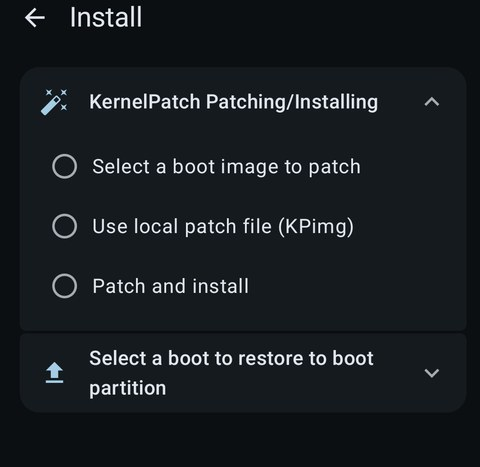

The `Patches` page shows the kernel of the selected image. For 20261026 it ends with
`Mon Oct 26 07:24:10 UTC 2026`; an image patched for an earlier build carries that build's kernel
and ramdisk, so do not reuse it. `Start` writes the patched image to `Download`:

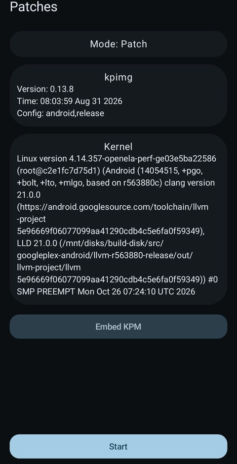 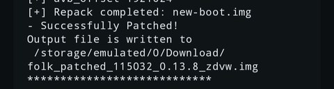

### Step 3: start OrangeFox

One of:

- `adb reboot recovery` (Android with USB debugging)
- Power menu, `Restart...`, `Recovery`. The menu offers `Recovery` only with `Advanced restart`
  enabled in Developer options.
- Phone off, then hold Power and Volume Up.

`fastboot reboot recovery` from the bootloader did not start OrangeFox on the test phones.

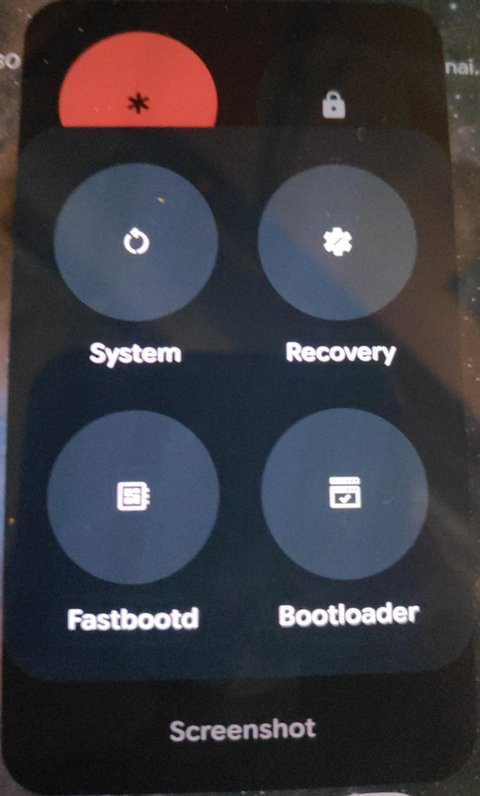 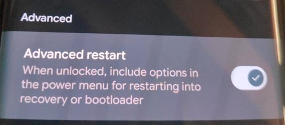

### Step 4: unlock /data

Tap an empty area of the screen once, then draw the pattern (see
[Known issue: first touch after boot](#known-issue-first-touch-after-boot)). A PIN or password is
entered on the same page with a keyboard.

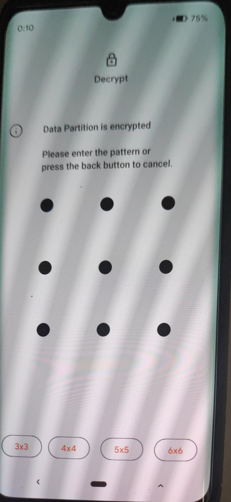

### Step 5: install the ROM and add-ons

1. `Files` tab, `/sdcard/Download`.

   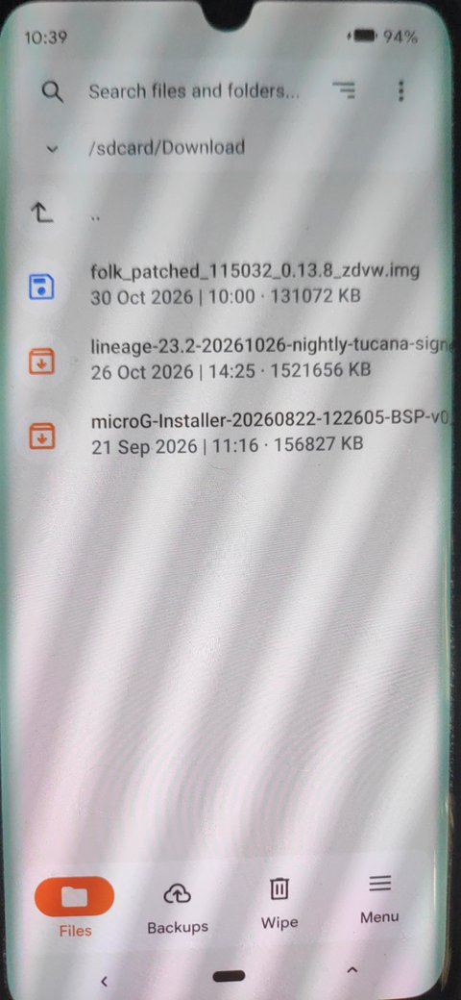

2. Tap the LineageOS zip. The `Install ZIP` page shows `1 of max of 10 Files queued`. Leave
   `Reboot after installation is complete` off.
3. `Add to Queue`, then the add-on zip. The queue now holds two files; the LineageOS zip is
   installed first.

   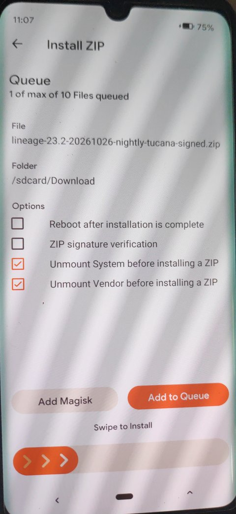 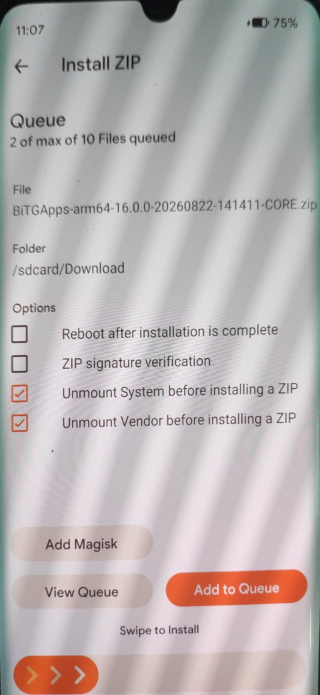

4. `Swipe to Install`. During the LineageOS zip the log shows `BiTGApps Backup Complete` before
   the partitions are written and `BiTGApps Restore Complete` after them (`MicroG Backup Complete`
   on the microG phone): the add-on's OTA survival script carries it over. Both test phones
   installed the add-on zip again in the same queue; whether the carried-over copy alone is enough
   was not tested.

   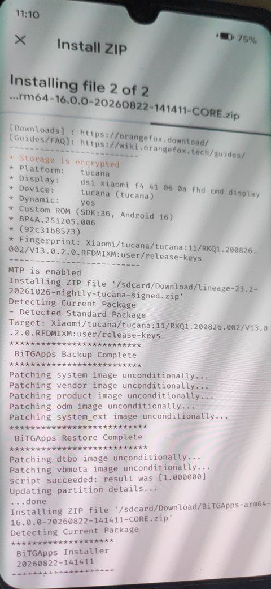 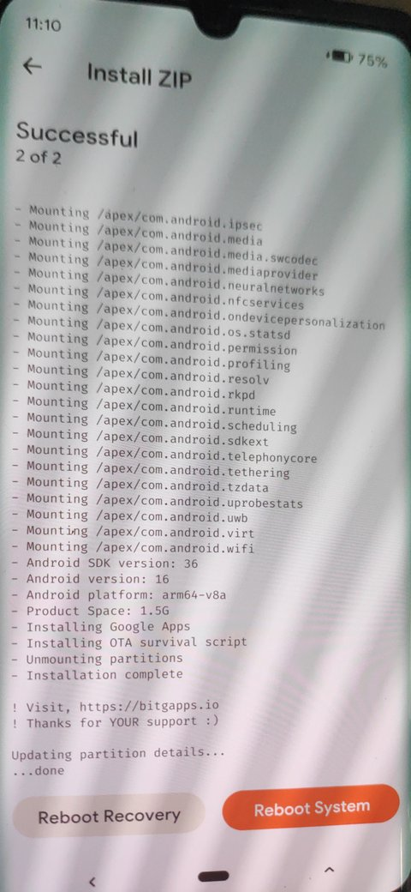

Without root, continue with step 7 or 8.

### Step 6: flash the patched boot image (root only)

Do this after the zips: the LineageOS zip writes its own, unpatched `boot.img`. `Files`,
`/sdcard/Download`, the patched image. The `Flash Image File` page asks for the partition: choose
`Boot` (not `Recovery`, not `Super`), then `Swipe to install Image`.

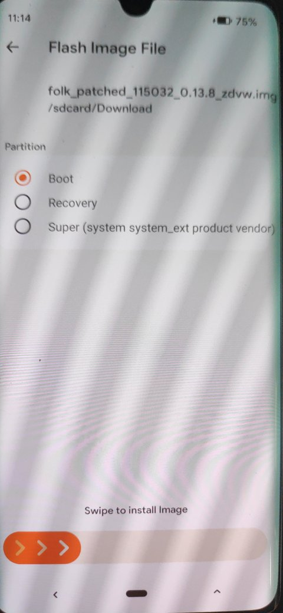 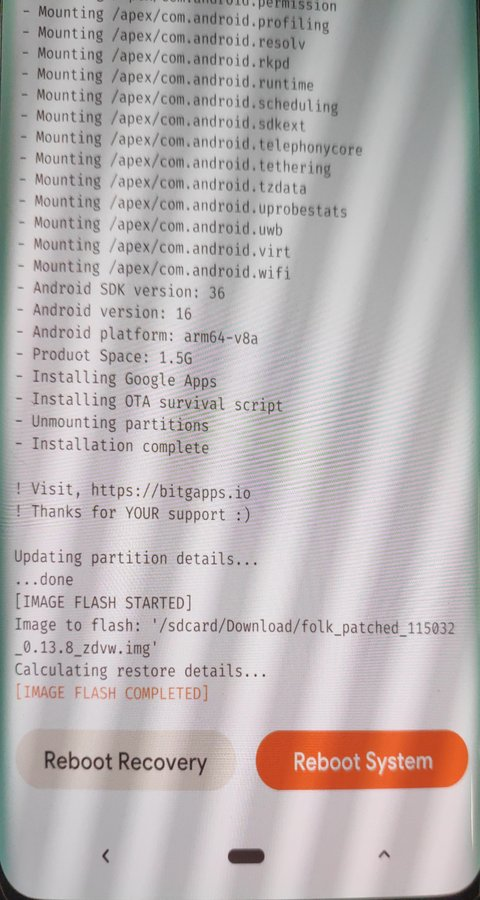

ROM, add-ons and root then start together at the first boot. If Android does not start, the cause
cannot be told apart: flash the unpatched `boot.img` from `Download` the same way (partition
`Boot`) and start again. The alternative order is to choose `Reboot System` after step 5, check
the first boot without root, then come back to OrangeFox (step 3) for this step.

### Step 7: check that OrangeFox stayed (optional)

Still in OrangeFox:

```
adb shell "sha256sum /dev/block/by-name/recovery"
```

The value is the SHA-256 of your OrangeFox image (`SHA256SUMS` on its release page). On the test
phones it printed `8a2549d31a2834e4151a1f0b7accbde479e5d43c9ea48ec5670658ea7be00fca`,
v2026.10.21-r3.

### Step 8: first boot

`Reboot System`. The LineageOS updater (Settings,
System, System updates) shows the installed build. With spoofing modules, About phone can show
`LineageOS version: Unknown`; the updater page still shows the build date and security update.

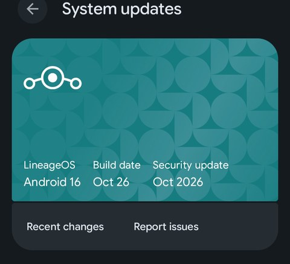 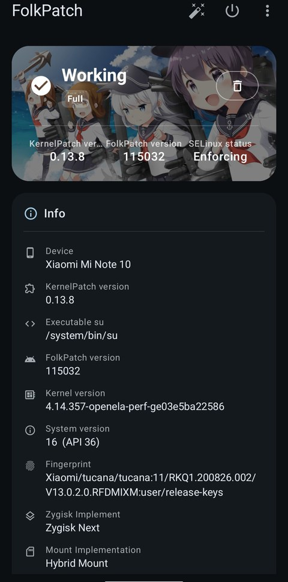

With root, the root manager should report that it works (FolkPatch: `Working`).

### When the security patch changes

If patch-check reports `RESULT: mismatch`, wait for an OrangeFox image built for the new build,
then:

1. Install the ROM and add-ons with the OrangeFox image that matches the current ROM (steps 1
   to 5).
2. `Reboot System` and let the new ROM start once. It upgrades the `/data` keys to the new
   values.
3. Flash the OrangeFox image that matches the new build: `fastboot flash recovery <OrangeFox .img>`
   from the bootloader, or from the older OrangeFox with `Flash Image File`, partition
   `Recovery`. At this point the older OrangeFox can no longer unlock `/data`, so `/sdcard` is not
   readable there: put the image on a USB stick, or `adb push <OrangeFox .img> /tmp/` (kept in RAM
   until reboot).

Booting the newer OrangeFox while the older ROM is still installed can upgrade the key, after
which that ROM cannot unlock `/data`.

After Format Data `/sdcard` does not exist until the ROM has booted once; copy files with a USB
stick or `adb push <file> /tmp/`.

## USB storage

A USB stick shows up as USB-OTG on the Mount page and as USB Storage in the storage menu of the
Files tab. FAT32, exFAT (kernel driver) and NTFS (`ntfs-3g`) are mounted. The phone has one USB
port: while a stick or hub is attached the phone is the USB host, so MTP and ADB are not
available. Turn MTP off on the Mount page before attaching the stick; with MTP still on, the first
mount attempt can fail.

## Known issue: first touch after boot

The first touch after boot is cut short by the touch controller (ST FTS panel): the kernel
reports a release while the finger is still on the screen. A pattern drawn as the first touch
arrives incomplete and counts as one failed attempt; later touches are normal. Tap an empty area
of the screen once before drawing the pattern. The same happens in the ROM, where it can cost one
digit of the SIM PIN. The cause is in the kernel and device tree (the Goodix and FTS drivers
configure the same reset and interrupt pins differently), not in OrangeFox.

## Building

1. Sync OrangeFox `fox_12.1` (see the OrangeFox wiki) into `<OrangeFox source tree>`.
2. Clone this repository to `<OrangeFox source tree>/device/xiaomi/tucana`.
3. Apply [recovery-patches/](recovery-patches/README.md) to `bootable/recovery`.
4. Build:

```bash
cd <OrangeFox source tree>
source build/envsetup.sh
for v in $(compgen -e | grep -E '^(OF_|FOX_)'); do unset "$v"; done
export TARGET_PRODUCT=twrp_tucana
source device/xiaomi/tucana/vendorsetup.sh
rm -f /tmp/tucana/fox_env.sh
lunch twrp_tucana-eng
touch bootable/recovery/orangefox.mk
mka adbd libminuitwrp mount.ntfs fsck.ntfs mkfs.ntfs libntfs-3g libfuse-lite
P=out/target/product/tucana
cp $P/system/lib64/{libminuitwrp,libntfs-3g,libfuse-lite}.so $P/recovery/root/system/lib64/
cp $P/system/bin/{mount,fsck,mkfs}.ntfs $P/recovery/root/system/bin/
rm -f $P/recovery.img $P/ramdisk-recovery.img $P/ramdisk-recovery.cpio
mka recoveryimage
```

Run the commands on separate lines: `source build/envsetup.sh` can return a non-zero status, so
a chain joined with `&&` stops after it. The output is
`out/target/product/tucana/OrangeFox-*-tucana.img` and `.zip`.

Why the extra lines:

- `vendorsetup.sh` exports its values only while `TARGET_PRODUCT` is `twrp_tucana`.
  `envsetup.sh` sources every `device/*/*/vendorsetup.sh` in alphabetical order, so in a source
  tree with other OrangeFox devices another device's values would otherwise be used.
- `lunch` writes the OrangeFox settings to `/tmp/tucana/fox_env.sh`, and the packaging step
  reads them from there. Check that `FOX_BUILD_DEVICE` is `tucana` and that
  `FOX_VIRTUAL_AB_DEVICE`, `FOX_VENDOR_BOOT_RECOVERY` and `FOX_AB_DEVICE` are not `1`. The values
  compiled into the recovery come from `bootable/recovery/orangefox.mk`, which Kati only re-reads
  when a makefile changes, hence the `touch`.
- `libminuitwrp.so` is copied into the ramdisk by a post-install command that does not run
  again in an incremental build. Since the colour change in `recovery-patches/`, the `recovery`
  binary needs the new library (`res_swap_red_blue`); an old copy keeps the recovery from
  starting. `recovery-inspect.ps1` checks this in its Display group. The NTFS tools
  (`TW_INCLUDE_NTFS_3G`: `mount.ntfs`, `fsck.ntfs`, `mkfs.ntfs`, `libntfs-3g.so`,
  `libfuse-lite.so`) reach the ramdisk the same way and are copied by hand too.
- The theme is copied into `recovery/root/twres`, but the ramdisk and the image do not depend on
  those files: after a change to theme files only, `mka recoveryimage` keeps the old image.
  Deleting `recovery.img`, `ramdisk-recovery.img` and the uncompressed `ramdisk-recovery.cpio`
  makes it rebuild all three; without the `.cpio` the old ramdisk is compressed again.

### Updating for a new LineageOS build

Take `kernel` and `dtb.img` from the new `boot.img` and `dtbo.img` from the new `dtbo.img`, then
set `PLATFORM_SECURITY_PATCH` (and `PLATFORM_VERSION` for a new Android version) in
`BoardConfig.mk` from the `boot.img` header. `VENDOR_SECURITY_PATCH` comes from
`ro.vendor.build.security_patch` in the ROM's `vendor/build.prop`.

## Tools

The two PowerShell scripts are shared by the Gursu-Bilisim OrangeFox repositories (tucana,
bramble, jackpotlte). They only read files and work in Windows PowerShell 5.1 and PowerShell 7.

### patch-check.ps1

Checks whether a recovery image fits a ROM build before you flash it. For a tucana
`recovery.img` the verdict comes from the image header: Android version and security patch must
match the ROM's `boot.img`. The kernel version is shown for information; a kernel difference
does not block decryption on tucana.
The `ROM fstab` and `Recovery fstab` lines show the `/data` entry of both images: fscrypt
policy and whether metadata encryption is used. On tucana both read
`v2+inlinecrypt_optimized+wrappedkey_v0` with metadata encryption; if the fscrypt versions
differ, the image cannot decrypt `/data` on that ROM.

```
powershell -ExecutionPolicy Bypass -File patch-check.ps1 -BootImg <boot.img> -RecoveryImg <OrangeFox .img | .zip>
powershell -ExecutionPolicy Bypass -File patch-check.ps1 -Zip <ota.zip> -RecoveryImg <OrangeFox .img | .zip>
```

Optional parameters: `-GoDumper`, `-MikDir` and `-PayloadTool` point to the payload tools,
`-WorkDir` sets the folder for temporary files (A/B packages only).

### recovery-inspect.ps1

Lists what an OrangeFox image contains, without flashing it. The script reads the device from
the image and runs that device's checks. For tucana: header v2 and DTB, the
`/dev/block/bootdevice` link, the QTI decryption chain (qseecomd and its listener libraries,
keymaster 4.1 and gatekeeper 1.0, VINTF manifest with keystore2), health HAL, display library and
USB. Accepts the `.img` or the OrangeFox `.zip`.

```
powershell -ExecutionPolicy Bypass -File recovery-inspect.ps1 -Img <OrangeFox .img | .zip>
```

### release.sh

Publishes the latest build as a GitHub release: image, zip, both scripts, `TEST-NOTES.md` and
`SHA256SUMS`. It stops if `test-notes.md` is older than the image, if the image's SHA-256 is not
recorded in `test-notes.md`, or if `bootable/recovery` no longer matches
`recovery-patches/bootable_recovery.diff`. `./release.sh r2` adds a suffix for a second release
on the same day; `FOX_TREE=<OrangeFox source tree> ./release.sh` if the build is not three
folders above the device tree.

## Credits and license

This tree started as a fork of [LIECOTI/tucana-orangefox](https://github.com/LIECOTI/tucana-orangefox)
and uses work from TeamWin, LineageOS and OrangeFox. [NOTICE](NOTICE) lists every source and its license.

- Files written for this repository: Apache License 2.0 ([LICENSE](LICENSE)).
- Changes to the OrangeFox/TWRP recovery source: GPL-3.0-or-later, published in
  [recovery-patches/](recovery-patches/).
- Prebuilt Qualcomm and Xiaomi vendor files: not covered by either license.

If you reuse parts of this tree, keep the NOTICE file and credit the sources it lists.
